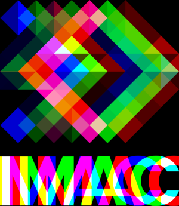
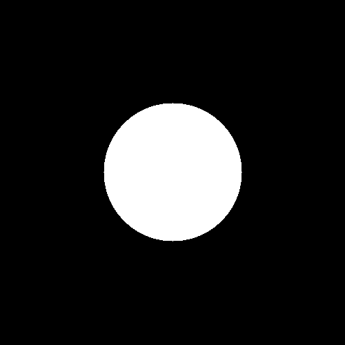
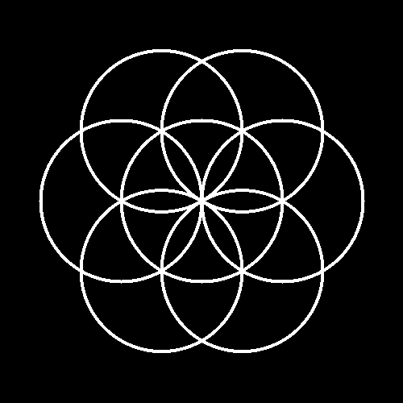
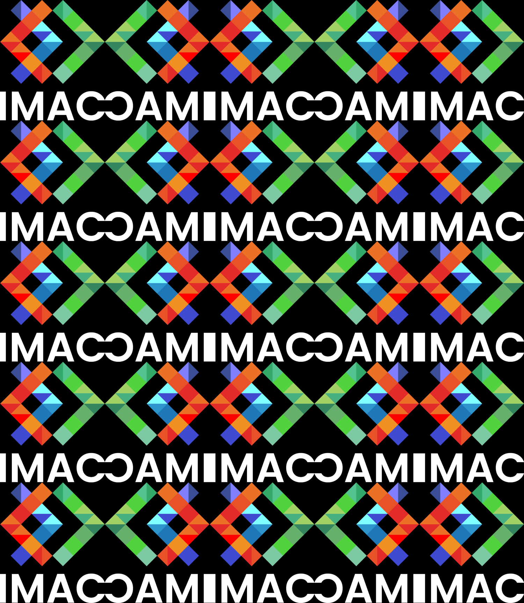

# Rapport de rendu — WORSHOP Prog et Algo

**Nom :** Pauline Quérard    

---

## Exercice 1 — Keep Green Only

| Image avant | Image après |
|:---:|:---:|
|  |  |

**Fonctionnement de l'algorithme :**

---

## Exercice 2 — Channels Swap

| Image avant | Image après |
|:---:|:---:|
|  |  |

**Fonctionnement de l'algorithme :**

---

## Exercice 3 — Black and White

| Image avant | Image après |
|:---:|:---:|
|  |  |

**Fonctionnement de l'algorithme :**

---

## Exercice 4 — Negatif

| Image avant | Image après |
|:---:|:---:|
|  |  |

**Fonctionnement de l'algorithme :**

---

## Exercice 5 — Gradient

| Dégradé |
|:---:|
|  |

**Fonctionnement de l'algorithme :**

---

## Exercice 6 — Mirror

| Image avant | Image après |
|:---:|:---:|
|  |  |

**Fonctionnement de l'algorithme :**

---

## Exercice 7 — Noise

| Image avant | Image après |
|:---:|:---:|
|  |  |

**Fonctionnement de l'algorithme :**

---

## Exercice 8 — Rotate

| Image avant | Image après |
|:---:|:---:|
|  |  |

**Fonctionnement de l'algorithme :**

---

## Exercice 9 — RGB Split

| Image avant | Image après |
|:---:|:---:|
|  |  |

**Fonctionnement de l'algorithme :**

---

## Exercice 10 — Brightness

| Image avant | Image éclaicissement | Image assombrissement |
|:---:|:---:|:---:|
|  |  |  |

**Fonctionnement de l'algorithme :**

---

## Exercice 11 — Disque

| Disque |
|:---:|
|  |

**Fonctionnement de l'algorithme :**

---

## Exercice 12 — Circle

| Circle |
|:---:|
|  |

**Fonctionnement de l'algorithme :**

---

## Exercice 13 — Animation

| Animation |
|:---:|
|  |

**Fonctionnement de l'algorithme :**

---

## Exercice 14 — Rosace

| Rosace |
|:---:|
|  |

**Fonctionnement de l'algorithme :**

---

## Exercice 15 — Mosaique

| Image avant | Image après |
|:---:|:---:|
|  |  |

**Fonctionnement de l'algorithme :**

---

## Exercice 16 — Mosaique Mirror

| Image avant | Image après |
|:---:|:---:|
|  |  |

**Fonctionnement de l'algorithme :**

---

## Exercice 17 — GLitch

| Image avant | Image après |
|:---:|:---:|
|  |  |

**Fonctionnement de l'algorithme :**

---

## Exercice 18 — Tri pixels

| Image avant | Image après |
|:---:|:---:|
|  |  |

**Fonctionnement de l'algorithme :**

---

## Exercice 19 — Tri lignes

| Image avant | Image après |
|:---:|:---:|
|  |  |

**Fonctionnement de l'algorithme :**

---

## Exercice 20 — Tri aléatoire

| Image avant | Image après |
|:---:|:---:|
|  |  |

**Fonctionnement de l'algorithme :**

---

## Exercice 21 — Fractale

| Fractale |
|:---:|
|  |

**Fonctionnement de l'algorithme :**

---

## Exercice 22 — Color Gradient

| Color Gradient |
|:---:|
|  |

**Fonctionnement de l'algorithme :**

---

## Exercice 23 — Tramage

| Image avant | Image après |
|:---:|:---:|
|  |  |

**Fonctionnement de l'algorithme :**

---

## Exercice 24 — Box Blur

| Image avant | Image après |
|:---:|:---:|
|  |  |

**Fonctionnement de l'algorithme :**

---

## Bilan 

