# Rapport de rendu — WORKSHOP Prog et Algo

**Nom :** Pauline Quérard    

---

## ★ Exercice 1 — Keep Green Only


| Image avant | Image après |
|:---:|:---:|
|  |  |

---

## ★ Exercice 2 — Channels Swap

| Image avant | Image après |
|:---:|:---:|
|  |  |

---

## ★ Exercice 3 — Black and White

| Image avant | Image après |
|:---:|:---:|
|  |  |

---

## ★ Exercice 4 — Negative

| Image avant | Image après |
|:---:|:---:|
|  |  |

---

## ★ Exercice 5 — Gradient

| Dégradé |
|:---:|
| 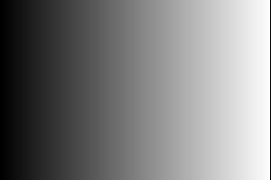 |

**Remarques :**   
Pendant longtemps, je n'obtenais qu'une image entièrement noire. Le problème venait du fait que je faisais une division entière (int / int), ce qui supprimait la partie décimale du résultat.

Pour obtenir un dégradé, j'avais besoin d'un résultat flottant (float). J'ai donc dû convertir l'une des deux valeurs en float avant d'effectuer la division.

---

## ★★ Exercice 6 — Mirror

| Image avant | Image après |
|:---:|:---:|
|  |  |

**Remarques :**   
Mon premier essai ne m'a pas donné l'image entièrement inversée, mais une moitié de l'image inversée :   

  
 ```cpp
 image.pixel(x, y) = image.pixel(image.width() - (x + 1), y);
```
 
Le problème venait du fait que je modifiais directement l'image d'origine tout en utilisant cette même image comme référence pour récupérer les pixels.
En effet, certains pixels étaient déjà modifiés au moment où je voulais les utiliser, ce qui faussait le résultat.

---

## ★★ Exercice 7 — Noise

| Image avant | Image après |
|:---:|:---:|
|  | 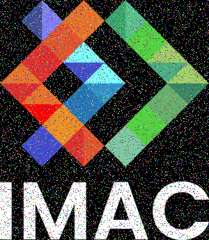 |

---

## ★★ Exercice 8 — Rotate

| Image avant | Image après |
|:---:|:---:|
|  |  |

**Remarques :**   
J'ai réalisé 3 versions pour cette fonction :
- Une version où je réutilise la fonction "Mirror"
- Une version où l'image est tournée vers la droite
- Une version où l'image est tournée vers la gauche et sans la fonction "Mirror"

---

## ★★ Exercice 9 — RGB Split

| Image avant | Image après |
|:---:|:---:|
|  |  |

---

## ★★ Exercice 10 — Brightness

| Image avant | Image éclaircissement | Image assombrissement |
|:---:|:---:|:---:|
|  |  |  |

---

## ★★(★) Exercice 11 — Disk

| Disk |
|:---:|
|  |

---

## ★★ Exercice 12 — Circle

| Circle |
|:---:|
| 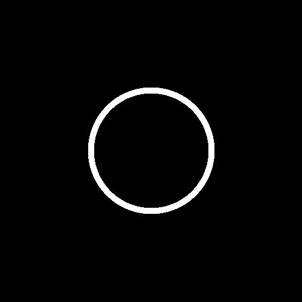 |

---

## ★★ Exercice 13 — Animation

| Animation |
|:---:|
| 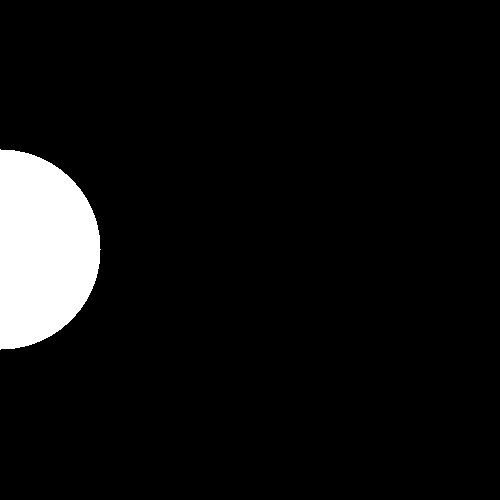 |

**Remarques :**   
Au départ, je rencontrais un problème : le disque laissait une sorte de "trace" derrière lui lorsqu'il se déplaçait.
Cela venait du fait que je dessinais à chaque fois sur l'image précédemment modifiée.
J'ai alors créé une copie de l'image originale (imageRef) à chaque itération.


---

## ★★★ Exercice 14 — Rosace

| Rosace |
|:---:|
|  |

---

## ★★ Exercice 15 — Mosaic

| Image avant | Image après |
|:---:|:---:|
|  |  |

---

## ★★★ Exercice 16 — Mosaic Mirror

| Image avant | Image après |
|:---:|:---:|
|  |  |

---

## ★★★ Exercice 17 — Glitch

| Image avant | Image après |
|:---:|:---:|
|  |  |

---

## ★★★ Exercice 18 — Pixel Sorting

| Image avant | Image après |
|:---:|:---:|
|  | 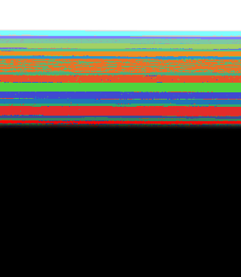 |

---

## ★★★ Exercice 19 — Rows Sorting 

| Image avant | Image après |
|:---:|:---:|
|  | 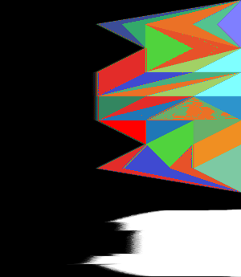 |

---

## ★★★ Exercice 20 — Random Sorting

| Image avant | Image après |
|:---:|:---:|
|  |  |

---

## ★★★(★) Exercice 21 — Mandelbrot Fractal

| Mandelbrot Fractal |
|:---:|
| 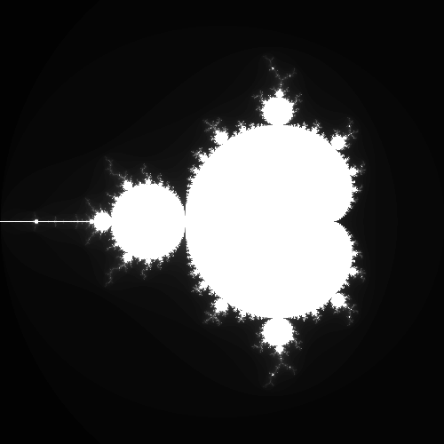 |

---

## ★★★(★) Exercice 22 — Color Gradient

| Color Gradient |
|:---:|
| 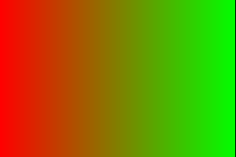 |

**Remarques :**
Pour cet exercice (seulement la première partie) j'ai réalisé deux versions :
- Une en utilisant glm::mix
- Une autre en passant ma variable "t" pour chaque couleur

---

## ★★★(★) Exercice 23 — Halftone

| Image avant | Image après |
|:---:|:---:|
|  |  |

---

## ★★★★ Exercice 24 — Vortex

| Image avant | Image après |
|:---:|:---:|
|  | 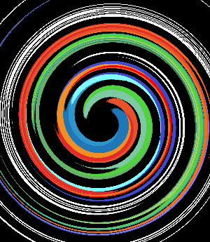 |

**Remarques :**   
Un de mes premiers rendus ressemblait à ça :   
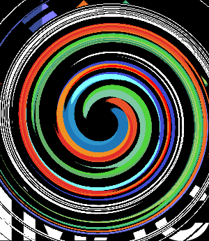   
Lors de mes premiers essais, j'obtenais un résultat où le vortex était bien présent, mais où l'image originale restait visible en arrière-plan.
Le problème venait du fait que je travaillais sur une copie de l'image originale. Les pixels qui n'étaient pas remplacés par la transformation gardaient donc leur couleur d'origine. J'ai alors créé une nouvelle image vide dans laquelle je recopie uniquement les pixels correspondant aux nouvelles coordonnées calculées.

Aussi, en jouant avec la valeur de l'angle, on peut réaliser des rendus assez originaux, par exemple en mettant : 
```cpp
float angle = x * glm::distance(point, center) * (2 * M_PI / 6);
```
Cela entraîne des variations beaucoup plus importantes de l'angle et crée des motifs différents, avec des déformations et des répétitions liées aux rotations successives.
Nous obtenons :    
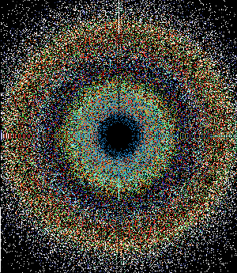

---

## ★★★★ Exercice 25 — Convolutions

| Image avant | Box Blur |
|:---:|:---:|
|  |  |

| Sharpen | Outline | Emboss |
|:---:|:---:|:---:|
|  |  | |

**Remarques :**   
Au départ, je rencontrais des erreurs lorsque j'appliquais la convolution sur les pixels situés près des bords de l'image. Certains pixels à côté sélectionnés par le kernel pouvaient se trouver en dehors des dimensions de l'image.

Pour résoudre ce problème, j'ai ajouté une condition permettant de vérifier que les coordonnées des pixels voisins restent bien dans les limites de l'image avant d'accéder à leur couleur.
```cpp
if (newX >= 0 && newX < image.width() && newY >= 0 && newY < image.height())
```

---


